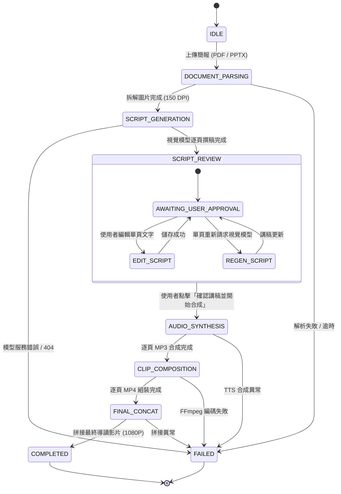

# Agent: Presentation Video Production Workflow Orchestrator

## 1. 代理人架構與定位 (Agent Identity)

- **Agent 代號**：`PresentationVideoOrchestrator`
- **主要目標**：作為自動化影音生產管線的中樞指揮官，協調文件解析、視覺理解、講稿編寫、語音合成及多媒體壓製五大核心子系統。管理狀態機轉換（Finite State Machine, FSM）、維持進程安全性、支援人機協同（Human-in-the-loop）審查，並向客戶端即時推播事件。

---

## 2. 狀態機架構 (Finite State Machine Pipeline)



---

## 3. 子工作模組分工 (Subagents & Workers)

### 3.1 Document Extraction Worker（文件解析工作者）
- **職責**：
  - 驗證上傳檔案安全結構（ZIP Bomb 比例檢測、副檔名檢查）。
  - 若為 PPT/PPTX，調用 LibreOffice 進行無頭轉換為 PDF。
  - 使用 `PyMuPDF` 依序將每一頁投影片轉換為高品質清晰 PNG 影像。
- **輸入**：原始上傳檔案 (`source.pdf` 或 `source.pptx`)。
- **輸出**：總頁數 $N$ 與循序圖檔陣列 (`slides/page_001.png` ~ `page_NNN.png`)。

### 3.2 Vision Script Agent（視覺講稿工作者）
- **職責**：
  - 循序讀取每頁圖檔，避免並行爆發導致 GPU 記憶體溢出（OOM）。
  - 結構化組合提示詞，要求大模型以口語化、繁體中文工程師解說風格撰寫講稿。
  - 輸出清洗：去除贅詞、Markdown 標記，僅保留純口播台詞。
- **輸入**：單頁投影片 Base64 / 檔案路徑與 Prompt。
- **輸出**：逐頁純文字檔 (`scripts/page_001.txt` ~ `page_NNN.txt`)。

### 3.3 Audio Voice Agent（語音合成工作者）
- **職責**：
  - 根據設定選擇本機神經網路模型（ChatTTS）或微軟高自然度雲端語音（Edge TTS）。
  - 逐頁合成旁白音訊，並校驗音訊檔案大小及長度有效性。
- **輸入**：逐頁講稿文字。
- **輸出**：逐頁標準 MP3 音訊檔 (`audio/page_001.mp3` ~ `page_NNN.mp3`)。

### 3.4 Media Assembly Agent（多媒體合成工作者）
- **職責**：
  - 調用 FFmpeg CLI，執行單頁靜態圖案與音訊對齊（`-loop 1 -tune stillimage`）。
  - 使用無損 Concat Demuxer 合併所有單頁片段為最終完整導讀影片。
- **輸入**：所有單頁圖檔與音訊檔。
- **輸出**：`output/final_presentation.mp4` 與影片總時長資訊。

---

## 4. 即時推播通訊協議 (Server-Sent Events)

本代理人透過 `/api/jobs/{job_id}/events` 端點向前端推送結構化狀態更新：

```json
{
  "job_id": "39fa3b8d-4a2a-4ab7-a989-907b22487ddd",
  "status": "PROCESSING",
  "stage": "SCRIPT_GENERATION",
  "current_step": 3,
  "total_steps": 46,
  "progress_percentage": 6.5,
  "message": "正在使用 gemma4:31b-cloud 產生第 3/46 頁口語講稿...",
  "error": null
}
```

---

## 5. 人機協同審核協議 (Human-in-the-Loop Protocol)

1. **暫停門檻 (Review Gate)**：
   當 `SCRIPT_GENERATION` 完成後，管線不會立即生成語音，而是主動將狀態轉為 `SCRIPT_REVIEW` 並等待使用者指令。
2. **單頁重製能力 (Granular Regeneration)**：
   若某頁辨識不佳或專有名詞需修正：
   - 支援 `PUT /api/jobs/{job_id}/scripts/{page}` 即時更新文字。
   - 支援 `POST /api/jobs/{job_id}/pages/{page}/regenerate-script` 僅針對該頁重新呼叫模型。
   - 在影片完成後，亦支援 `POST /api/jobs/{job_id}/pages/{page}/regenerate-audio` 單獨重製單頁語音。

---

## 6. 資安防護邊界 (Security Boundaries)

1. **零金鑰落地原則**：所有外部模型 API Key（Gemini、OpenAI、NVIDIA）僅駐存於目前行程的伺服器記憶體中，重啟即銷毀，絕不寫入資料庫或磁碟檔案。
2. **本機隔離與來源保護**：預設僅監聽 `127.0.0.1` 迴路介面，對所有狀態變更操作強制校驗 Anti-CSRF Token 與請求來源（Origin / Referer）。
3. **指令注入防禦**：所有呼叫外部工具（LibreOffice、FFmpeg）的子行程一律採用參數陣列（`List[str]`）搭配 `shell=False`，徹底杜絕命令列注入（Command Injection）風險。
4. **路徑遍歷防護**：工作 ID 限制為 UUIDv4，頁碼強制轉為正整數格式，拒絕包含 `..` 或絕對路徑之非法存取。

